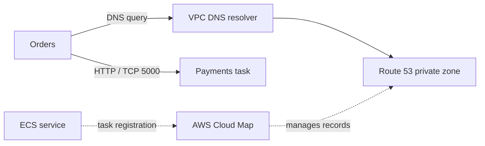

# ECS Networking & Service Discovery Lab

A hands-on AWS Fargate lab exploring how two microservices communicate through private networking and AWS Cloud Map DNS service discovery — and what changes when tasks scale or fail.

Companion article: [Inside ECS Networking: What Service Discovery and DNS Reveal About Microservices Communication](https://www.edgarcloudnotes.com/inside-ecs-networking-what-service-discovery-and-dns-reveal-about-microservices-communication/)

Companion series: **Cloud in Practice**, on [Practical Cloud Lab](https://www.youtube.com/channel/UCpmDKumnarynaM7OF9NYV3A). This repository supports the first episode. The channel link is not a direct link to a published episode.

## What this lab covers

- ECS Fargate tasks using the `awsvpc` network mode and private IP addresses
- AWS Cloud Map private DNS namespace `lab.internal` and the service name `payments.lab.internal`
- Direct HTTP communication from Orders to Payments on port 5000
- DNS multivalue responses versus **actual request distribution**
- Single-task interruption, complete service outage, and eventual recovery

## Architecture

Two containerized Python/Flask services run as independent ECS services in private VPC subnets:

- **Orders** — port `4000`, `GET /health` and `GET /checkout`; calls `http://payments.lab.internal:5000/payment` (configurable through `PAYMENTS_URL`).
- **Payments** — port `5000`, `GET /health` and `GET /payment`; its response includes the responding task's hostname and IP.
- **Cloud Map** — private namespace `lab.internal`, `payments` service, multivalue `A` records, DNS TTL of 10 seconds in the original experiment.

Typical flow: Client or test process → Orders → DNS lookup for `payments.lab.internal` → direct HTTP connection to a Payments task. **Cloud Map resolves names; it is not an HTTP proxy.**



## Repository layout

| Directory | Purpose |
| --- | --- |
| `apps/orders/` | Original Orders Flask app, dependencies and Dockerfile |
| `apps/payments/` | Original Payments Flask app, dependencies and Dockerfile |
| `scripts/` | Reproducible DNS, distribution, connectivity and outage probes; reconstructed for this repository |
| `docs/lab-setup.md` | AWS networking, ECR, ECS and Cloud Map deployment guide |
| `docs/experiments.md` | Step-by-step experiment walkthroughs and expected observations |
| `docs/results.md` | Recorded results and interpretation from the original lab |

## Quick local smoke test

Use a virtual environment so the lab does not modify your system Python:

```bash
python -m venv .venv
source .venv/bin/activate
python -m pip install -r apps/orders/requirements.txt -r apps/payments/requirements.txt
```

In PowerShell, activate with `.venv\\Scripts\\Activate.ps1`. Activate the same environment in both application terminals.

Run each service from its own directory in two terminals using Python 3.12+:

1. `cd apps/payments && python -m pip install -r requirements.txt && python app.py`
2. `cd apps/orders && python -m pip install -r requirements.txt && PAYMENTS_URL=http://127.0.0.1:5000 python app.py`
3. Call `curl http://127.0.0.1:4000/checkout` and check for a completed order with a Payments response.

On Windows PowerShell, set `$env:PAYMENTS_URL = 'http://127.0.0.1:5000'` before running Orders. Local execution does **not** test Cloud Map; for that, deploy to AWS.

For the local application contract tests, run `python -m unittest discover -s tests -v` from the repository root. These tests mock the downstream HTTP call; they do not create AWS resources or validate DNS propagation.

## Reproduce the AWS experiments

1. Follow [the AWS setup guide](docs/lab-setup.md).
2. Run [the DNS and request-distribution experiments](docs/experiments.md).
3. Compare with [the actual recorded lab results](docs/results.md).

**Important:** The apps came from the original ZIP used for the article. The scripts and deployment documentation are newly written reproductions because the original monitoring scripts and AWS infrastructure configuration were not in that ZIP. AWS console and CLI settings should be verified in your own account.

## Key observation

In the original lab, Cloud Map returned **three** task IP addresses, but **30 successive hostname-based HTTP requests** all reached the same Payments task. DNS discovery of multiple endpoints does not guarantee per-request balancing. Client behavior, address selection, connection reuse, and caching can affect outcomes.

When one Payments task was stopped, the monitored calls continued succeeding through a surviving task; when Payments was intentionally scaled to zero, the caller saw DNS resolution and connection errors rather than an HTTP 500 response.

## Safety and cost

This lab creates billable AWS resources (Fargate, networking, possible NAT Gateway, Cloud Map, ECR, logs). Review costs and follow the cleanup section in the setup guide. Do not commit AWS credentials, account-specific secrets, production URLs, or private environment configuration.

## License

See [LICENSE](LICENSE) for reuse terms.
